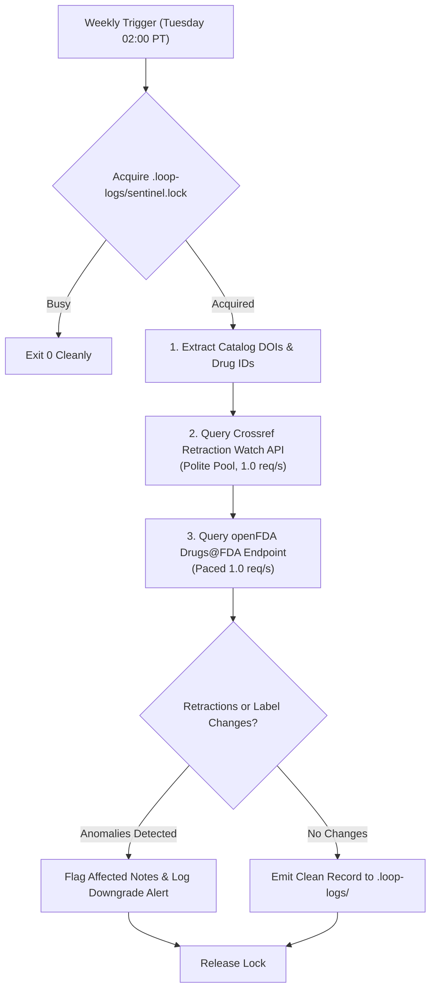

# Scientific integrity sentinel (`scheduled-evidence-integrity`)

Continuously protects the lab's scientific credibility by monitoring primary literature and regulator endpoints for retractions, expressions of concern, or indication modifications affecting cited CF evidence.

## Cadence & Trigger

- **Default Cadence**: Weekly on Tuesdays at 02:00 AM PT (`CRON_TZ=America/Los_Angeles 0 2 * * 2`).
- **Antigravity Sidecar ID**: `scheduled-evidence-integrity`
- **Review Tier**: `routine`

---

## Autonomous Verification Pipeline



### 1. Catalog DOI & Drug ID Extraction
Extract checkable identifiers from:
- `../cf-research/sources/catalog.yaml` (DOIs, drug entries `openfda-label`, `openfda-drugsfda`).
- Evidence ledgers and research proposals in `../cf-research/landscape/` and `../cf-research/proposals/`.

### 2. Crossref & Retraction Watch Surveillance
- Query the documented Crossref update-to relations endpoint (`catalog.yaml` entry `retraction-watch-crossref`):
  ```text
  https://api.crossref.org/works?filter=updates:<DOI>
  ```
- **Conduct & Etiquette**:
  - Paced strictly at **1.0 request per second** (`max_rps: 1.0`).
  - Pass a polite `User-Agent` header containing contact information.
  - Inspect returned notice types: `retraction`, `correction`, `expression_of_concern`.

### 3. openFDA Drug Label & Approval Tracking
- Query openFDA drug label and Drugs@FDA endpoints for approved CFTR modulators:
  - Elexacaftor/Tezacaftor/Ivacaftor (`TRIKAFTA` -> NDA212273)
  - Vanzacaftor/Tezacaftor/Deutivacaftor (`ALYFTREK`)
  - Ivacaftor (`KALYDECO` -> NDA203188)
  - Lumacaftor/Ivacaftor (`ORKAMBI` -> NDA206038)
  - Tezacaftor/Ivacaftor (`SYMDEKO` -> NDA210491)
- Verify approval history, boxed warnings, and age/genotype indications.

### 4. Non-Destructive Integrity Guardrails
- If a cited DOI is flagged as retracted:
  - **Never silently mutate or erase historical research files**.
  - Downgrade the dependent claim in `cf-research/landscape/` to `unverified`.
  - Append an explicit audit note referencing the retraction notice.
  - Propose a remedial task on `tasks/board.json` for human clinician/researcher review.
