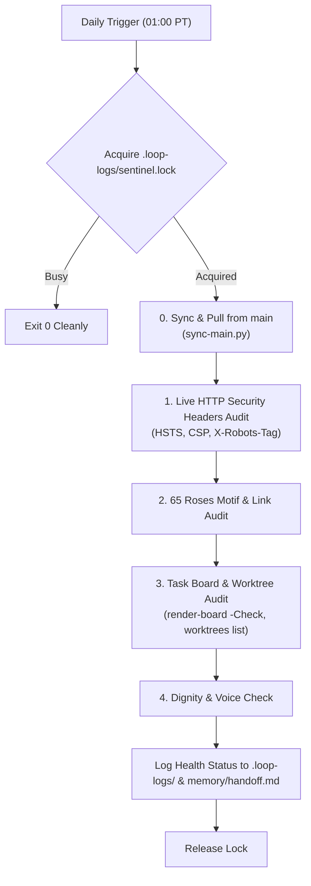

# Public site health & dignity sentinel (`scheduled-site-audit`)

Maintains unbroken operational quality, security posture, and dignity for the public lab website ([senseiewok.ai](https://senseiewok.ai/)) and control repository task board.

## Cadence & Trigger

- **Default Cadence**: Daily at 01:00 AM PT (`CRON_TZ=America/Los_Angeles 0 1 * * *`).
- **Antigravity Sidecar ID**: `scheduled-site-audit`
- **Review Tier**: `routine`

---

## 4-Point Health & Dignity Audit Pipeline



### 0. Advisory Mutex Lock & Sync with Main on Start
- Acquire advisory lock `.loop-logs/sentinel.lock` (if held and under 30 minutes old, back off and exit 0 cleanly). Release upon audit conclusion.
- **Sync with origin/main**: Always pull the latest `main` branch across workspace repositories before verifying task board, worktrees, or site assets:
  ```powershell
  python .claude/skills/workspace-siblings/scripts/sync-main.py
  ```
  Or manually: `git -C c:/senseiewok/repos/cf-lab pull --ff-only origin main && git -C c:/senseiewok/repos/.ai pull --ff-only origin main`.

### 1. Live HTTP Security Headers Audit
Verify that production web responses from `senseiewok.ai` return mandatory security and crawler headers:
- `Strict-Transport-Security: max-age=...; includeSubDomains; preload`
- `X-Content-Type-Options: nosniff`
- `Referrer-Policy: strict-origin-when-cross-origin`
- `X-Robots-Tag: noindex` on unreleased research atlas directories (per T-0139).
- Permanent 301 redirects (e.g. `/letter/` redirecting to `/letter`).

### 2. 65 Roses Visual Motif & Link Integrity
- Verify that exactly 65 rose motifs render on target pages (`/cf/`, `/`, `/es/`) adhering to the 65-rose community convention (T-0016).
- Verify zero broken internal links across the primary English and Mexican Spanish (`/es/`) discovery routes.

### 3. Task Board & Worktree Coordination Audit
- Run deterministic board validation:
  ```powershell
  pwsh -NoProfile -File tasks/render-board.ps1 -Check
  ```
- Run read-only worktree audit:
  ```powershell
  python .claude/skills/workspace-siblings/scripts/worktrees.py list
  ```
  > [!IMPORTANT]
  > **Maintainer Sovereignty Guardrail**: Worktrees are removed *only* with `--yes` when a person asks. Never execute `worktrees.py clean --yes` automatically inside a scheduled cron. If finished or dangling worktrees are detected, log them to `memory/handoff.md` for human review.

### 4. Tone, Dignity & Spanish Disclaimer Verification (Local Delegation)
- When orchestrating on Gemini Flash, **delegate the verification of Spanish disclaimer text and drafting of audit summaries to the preferred local worker (`qwen3.8:27b-64k`)** using `.claude/skills/ai-loop-council/scripts/invoke-local-model.ps1`:
  - Confirm all public pages conform to `lab-voice` boundaries (warm, plain-language, assertive, zero hype).
  - Verify that every Spanish page under `.ai/src/es/` carries the exact medical boundary disclaimer:
    > *"Investigación independiente, no asesoramiento médico. Sensei Ewok CF Lab no promete curas ni tratamientos clínicos."*

### 5. Logging & Top-Task Escalation (Argon)
- Emits daily audit log to `.loop-logs/site-audit-YYYY-MM-DD.json`.
- If critical regressions (e.g. broken CSP, missing disclaimer, or board render failure) are detected:
  - Escalate triage to **Argon** (Gemini 4 Argon / `pro` model via `invoke_subagent` with `Model: 'pro'`).
  - Log an elevated alert in `memory/handoff.md`.

