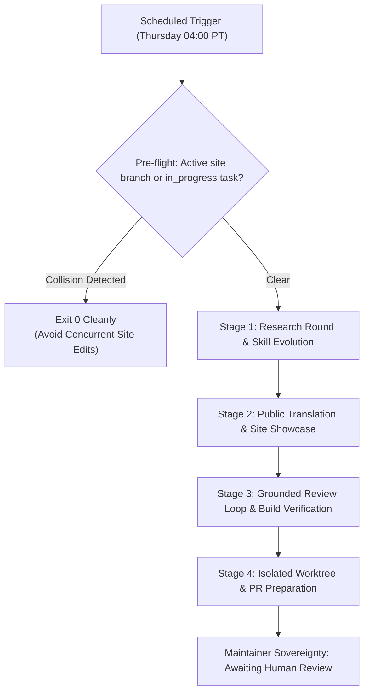

# Autonomous site builder & research showcase sentinel (`scheduled-site-showcase`)

Continuously builds and improves the public lab website ([senseiewok.ai](https://senseiewok.ai/)), conducting a fresh round of research and improving relevant skills on every run, exposing recent lab breakthroughs to the community in English and Spanish, and preparing verified pull requests with Playwright screenshots.

## Cadence & Trigger

- **Default Cadence**: Weekly on Thursdays at 04:00 AM PT (`CRON_TZ=America/Los_Angeles 0 4 * * 4`).
- **Antigravity Sidecar ID**: `scheduled-site-showcase`
- **Review Tier**: `elevated` / `full` (depending on public claims and security boundaries).

---

## 4-Stage Autonomous Workflow



### Pre-flight: Task Board & Worktree Coordination

Before touching any `.ai` or skill files:
1. Check `tasks/board.json` for any `.ai` task already marked `"status": "in_progress"` with a `"branch"` set, and check active git worktrees (`git -C ../.ai worktree list`).
2. If another agent or worktree is already working on the target site task or branch (e.g. `site/showcase-*` under `../.worktrees/.ai/`), **stop immediately and exit cleanly** so two agents never race on `.ai/src/`.
3. When claiming a `ready` site task, spawn the isolated worktree first, then set `"status": "in_progress"` and `"branch": "<branch-name>"` on the claimed task in `tasks/board.json` and run `pwsh -NoProfile -File tasks/render-board.ps1`.
4. **Never run check-all or tests at the beginning**: Strictly avoid running `check-all.ps1` or test suites (`tests.test_site`, `check-voice.py`, Playwright visual audits, or claims checkers) during Pre-flight or before changes are applied in the worktree. Running full `check-all.ps1` spends excessive execution time (several minutes across 30+ control-repo suites), risks spawning orphaned background server processes on test ports, and risks modifying or locking git index and worktree states. All deterministic testing belongs strictly in Stage 3 on the completed, staged changes in the dedicated worktree.

### Stage 1: Research Round & Skill Evolution

1. **Scan Completed Lab Research**:
   - Inspect `cf-research/landscape/` and `cf-research/proposals/` for recent T1/T2 dossiers (e.g. PTC readthrough, delivery biophysics, variant theratyping, alternative conductance).
   - Identify newly validated primary evidence, Cryo-EM coordinate updates, or trial surveillance records.
2. **Skill Audit & Improvement**:
   - Audit relevant skills (`frontend-design`, `lab-voice`, `cf-research-context`, `webgl-threejs-graphics`).
   - Integrate concrete, tested improvements (e.g., refined mobile viewport handling, new diagnostic checks, CSS container query patterns).
   - Validate that updated skills strictly conform to frontmatter and character limits:
     ```powershell
     python tasks/check-skill-frontmatter.py
     ```

### Stage 2: Exposing the Lab's Work (Public Translation)

1. **Evidence & Asset Generation**:
   - Re-generate public evidence ledgers:
     ```powershell
     python tools/make_evidence.py
     ```
   - Synchronize 3D CFTR atomic coordinates and mutation hotspots:
     ```powershell
     python tools/sync_cftr_model.py
     ```
2. **Website Enhancements (`.ai/src/`)**:
   - Update HTML, CSS, and interactive visualizers on target pages (`/cf/`, `/cf/cftr/`, `/tools/`, `/evidence/`).
   - Maintain the two-tier header navigation and right-hand secondary sub-nav rail (`aside.subnav-rail`) on content pages.
   - Preserve the 65-Roses visual motif counter and semantic structure.
3. **Mexican Spanish Localization (`/es/...`, `es-MX`)**:
   - Author or update parallel Mexican Spanish pages under `.ai/src/es/` (e.g., `/es/`, `/es/cf/`, `/es/cf/cftr/`) with `<html lang="es-MX">` and reciprocal `hreflang="es-MX"` / `hreflang="en"` links.
   - Use natural Mexican Spanish vocabulary (`computadora`, `archivo`, `teléfono celular`, `ustedes`, `consultar con su equipo médico`) and include the verified Spanish medical boundary disclaimer:
     > *"Investigación independiente, no asesoramiento médico. Sensei Ewok CF Lab no promete curas ni tratamientos clínicos."*

### Stage 3: Deterministic Grounded Review Loop & Verification

Execute the mandatory 3-layer Grounded Review Loop:

1. **Deterministic Mechanical Verification**:
   - Verify all factual claims against primary sources:
     ```powershell
     python ../cf-research/tools/claims/check_claims.py
     python ../cf-research/tools/claims/check_numbers.py
     ```
   - Check voice, tone, and lack of hype across all HTML files:
     ```powershell
     python .claude/skills/lab-voice/scripts/check-voice.py
     ```
   - Run the site unit and CLS test suite:
     ```powershell
     python -m unittest tests.test_site tests.test_resources_page tests.test_cftr_hero tests.test_site_cls
     ```
2. **Playwright Visual Audit**:
   - Launch local test server and capture desktop (`1280x800`) and mobile (`390x844`) screenshots:
     ```powershell
     python .claude/skills/playwright-browser-testing/scripts/pr-screenshots.py capture --url http://localhost:8000
     ```
   - Inspect screenshots in `../cf-lab-files/scratch/screenshots/` to verify zero visual overlap, no mobile overflow, and legible typography.

### Stage 4: Worktree & PR Preparation Pipeline

1. **Spawn Isolated Git Worktree & Record Branch**:
   - Never commit directly to `main`; use `<prefix>/<topic>` branch naming and push to `origin` immediately:
     ```powershell
     python .claude/skills/workspace-siblings/scripts/worktrees.py new .ai showcase-<topic> --prefix site --push
     ```
   - Ensure the claimed task row in `tasks/board.json` records `"branch": "site/<topic>"` (or the exact git branch name) so concurrent agents see the active branch.
2. **Elevated Gate Enforcement**:
   - Stage and verify through the repo gate:
     ```powershell
     pwsh -NoProfile -File .claude/skills/ai-loop-council/scripts/run-gate.ps1 -Tier elevated -Expected "<changed-files>" -MessageFile <path-to-commit-msg>
     ```
3. **Execute `pr-review-loop` with Diversity Frontier Council (Opus + Gemini)**:
   - Before opening or submitting any PR, openly request a dual-family frontier council review pairing Anthropic Claude Opus and Google Gemini (Family B + Family A) without enforcing who orchestrates.
   - The blind challenger from the opposing family reviews the staged diff; the orchestrator adjudicates each finding against deterministic tests.
   - Record the full review loop table (rounds, findings, accepted, rejected) in the PR description.
4. **Submit Pull Request**:
   - Open PR via GitHub CLI:
     ```powershell
     gh pr create --repo senseiewok/.ai --title "feat(site): <description>" --body-file pr-body.md
     ```
   - Attach Playwright screenshots and link back to the originating research dossier.

---

## Safety & Governance

- **Zero Invention**: Every number, structure, and claim originates from primary peer-reviewed literature or official trial registries.
- **Maintainer Sovereignty**: The agent prepares clean worktrees and opens PRs; only the human maintainer merges code or deploys to production.
- **Test Timing Discipline**: Never execute test suites at the beginning of a run. Verification checks run exclusively in Stage 3 against the concrete changes made in the isolated worktree.
