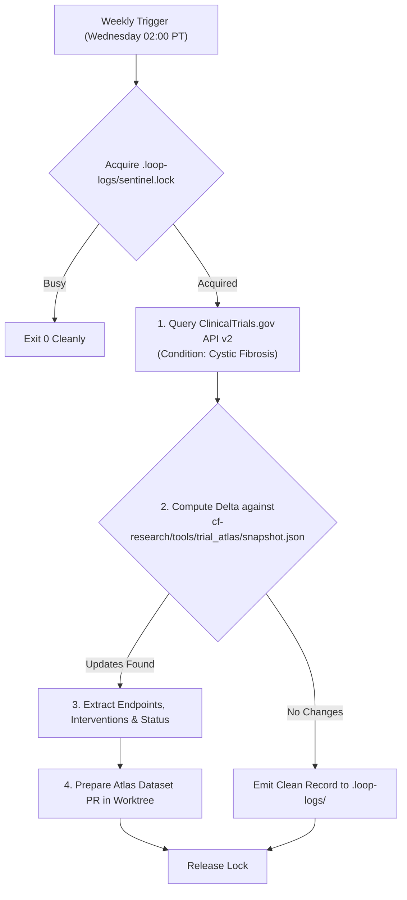

# Clinical trial surveillance sentinel (`scheduled-trial-surveillance`)

Continuously tracks global interventional Cystic Fibrosis clinical trials, detecting new study starts, status transitions (recruiting, completed, suspended, terminated), and published results to keep the lab's Trial Endpoint Atlas perpetually up to date.

## Cadence & Trigger

- **Default Cadence**: Weekly on Wednesdays at 02:00 AM PT (`CRON_TZ=America/Los_Angeles 0 2 * * 3`).
- **Antigravity Sidecar ID**: `scheduled-trial-surveillance`
- **Review Tier**: `elevated`

---

## Surveillance & Atlas Integration Pipeline



### 1. ClinicalTrials.gov API v2 Querying
- Query the official API endpoint per `catalog.yaml` (`clinicaltrials-api`):
  ```text
  https://clinicaltrials.gov/api/v2/studies?query.cond=Cystic+Fibrosis&filter.overallStatus=RECRUITING,ACTIVE_NOT_RECRUITING,COMPLETED,TERMINATED,SUSPENDED
  ```
- **Conduct & Pacing**:
  - Respect `catalog.yaml` bounds: maximum 1.0 request/second (`max_rps: 1.0`).
  - Retrieve machine-readable JSON; never crawl the web front-end.

### 2. State Delta Evaluation & Atlas Update
- Compare retrieved NCT IDs and status fields against `cf-research/tools/trial_atlas/`.
- Flag significant trial transitions:
  - Phase advances or completions.
  - Terminations or safety halts (e.g. VX-522 inhaled mRNA program).
  - New interventional modalities (mRNA, AAV, prime editing, ENaC inhibitors, TMEM16A potentiators, bacteriophage).

### 3. Safety & Mandatory Registry Disclaimers
- Every output or dataset updated by this sentinel must include the mandatory ClinicalTrials.gov disclaimer:
  > *"ClinicalTrials.gov does not evaluate safety or efficacy; listing on the registry does not denote government endorsement."*
- When new trials are staged, changes are drafted in an isolated git worktree under `.worktrees/cf-research/` and submitted via `gh pr create` for maintainer review.
